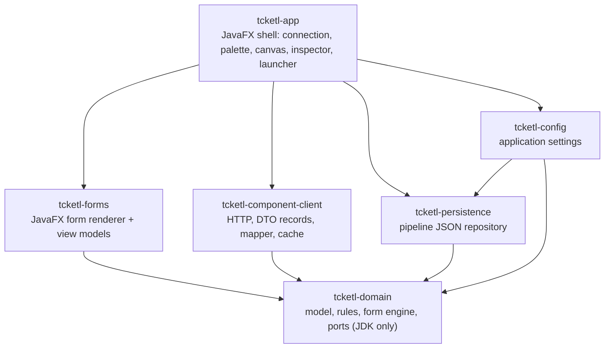
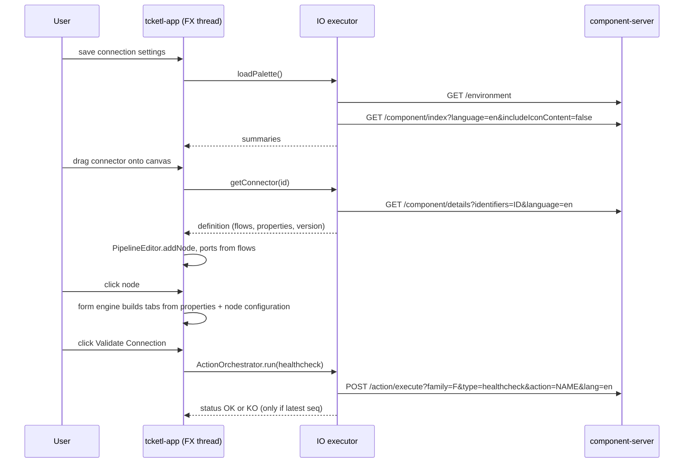

# tcketl - Plan, progress and remaining work

> **Living document** - last updated 2026-11-01, after sub-step P7a. It is written so that a developer (or an AI
> session) can resume the work without any other context. **(confirmed)** = validated by the user, **(default)** = my
> assumption. Where the code and this file disagree, the code wins (and this file should be fixed).
> Inputs: `documentation-integration/` (`07-designer-blueprint.md`, `05-configuration-and-ui.md`,
> `03-component-server-api.md`), `docs/development-plan.md`, `docs/tck-api-sample/*`, `component-server-parent`.

## 0. Status at a glance

**Where we stopped**: P0-P9 are **done and verified** (M0-M5). **P10 is partly done**: migration on load (`ConfigurationMigrator`, `HttpConfigurationMigrator`, hooked in `NodeResolver`, never downgrades) and 30 s environment polling and a documentation window (button in the inspector) (`EnvironmentWatcher` + link in the status bar). **Deferred (not implemented)**: node validity badge on the canvas, undo/redo, keyboard shortcuts beyond menus, credential masking (R8), `jpackage` image. **P11**: `tcketl/docs/specification.md` and `architecture.md` written (extracted from this plan); README updated. The working tree compiles, every
gate is green and nothing is committed.

Last verification (`mvn -f tcketl/pom.xml -o verify`, from the repository root): **BUILD SUCCESS**, Checkstyle 0
violations, RAT 0 unapproved files.

| Module | Tests | Note |
|---|---|---|
| `tcketl-domain` | 217 | |
| `tcketl-persistence` | 67 | |
| `tcketl-config` | 46 | |
| `tcketl-component-client` | 92 | |
| `tcketl-forms` | 33 | `WidgetSelectorTest` 24, `FormViewModelTest` 5, `TextsTest` 4 |
| `tcketl-app` | 147 | of which 23 are opt-in UI tests, reported as skipped unless `-Dtcketl.ui.snapshots=<dir>` is given |

Total 602 tests, 579 executed by default.

| Phase | Name | Milestone | Status |
|---|---|---|---|
| P0 | Bootstrap and fixtures | **M0** empty window, `verify` green | done |
| P1 | Domain core | | done |
| P2 | Config and persistence | | done |
| P3 | Component-server client | | done |
| P4 | App shell, connection, palette | **M1** connect and browse the palette | done |
| P5 | Canvas, ports, links, save/load | **M2** build, save and reopen a pipeline | done |
| P6 | Form engine (pure, headless) | | done |
| P7 | Form renderer and inspector | **M3** click a node, get a tabbed form | **in progress**: 7a done, 7b-7e to do |
| P8 | `@ActiveIf` | **M4** conditional display works | done (badge deferred to P10) |
| P9 | Service calls (actions) | **M5** healthcheck, suggestions, validation, update, schema | done |
| P10 | Resilience and polish | | partly done (see above) |
| P11 | Packaging and hardening | | docs done; jpackage not produced |

**What the designer does today**: connect to a component-server (host, port, base path, scheme, language, "Test
connection"), browse the palette (families, search, icons, role glyphs, streaming badge), drag a connector onto the
canvas (its definition is loaded on demand), see its input/output ports, link an output to an input (rules enforced),
move, select, rename, delete, zoom, read the Problems list, save / open / save-as a pipeline (dirty flag, window
title). **Not yet**: the inspector on the right is still a placeholder (no form), no conditions, no service calls, no
migration, no documentation viewer, no environment polling, no undo/redo, no packaging.

**Next action when resuming**: P7b - create `FormBindings`, `Editors` and `forms.css` in `tcketl-forms` (design in 5,
P7).

## 1. Decisions and conventions

| # | Topic | Decision |
|---|---|---|
| D1 | JDK / language level | **(confirmed, twice: "utilise java 17, ne change pas le jdk")** Java 17 on the existing JDK; never change the JDK, `.tool-versions` or the root pom. `maven.compiler.release=17` is inherited, so code MUST compile with `--release 17`: records, sealed types, text blocks, `instanceof` patterns, `Stream.toList()`, `var` and arrow `switch` expressions are fine; **not available**: pattern matching for `switch`, record patterns, virtual threads, `SequencedCollection` methods, unnamed variables. Dev machine: OpenJDK 17.0.2. |
| D2 | UI toolkit | **(confirmed)** JavaFX **21.0.2** (LTS, needs JDK 17+): `javafx-controls`, `javafx-fxml`, pinned by `openjfx.version`. Smoke-tested on JDK 17.0.2: works. |
| D3 | Repo integration | **(confirmed)** `tcketl/` is a **standalone aggregator** (`tcketl-parent`, parent = root pom through `<relativePath>../pom.xml</relativePath>`), NOT in the root `<modules>`, root pom untouched, local builds only. An enforcer rule (`tcketl-build-from-repository-root`) fails any build that does not start from the repository root: always `mvn -f tcketl/pom.xml ...`. |
| D4 | Server model | **(confirmed)** Own immutable DTO records (Jackson) + anti-corruption mapper; **no compile dependency** on other component-runtime modules (`component-server-model` and `component-form` are not reused; `component-form-core` is javax.ws.rs based). `tcketl/` can be extracted into its own repository. |
| D5 | Coordinates | `groupId=org.talend.sdk.component`, version = root version (`1.2611.0-SNAPSHOT`), packages `org.talend.sdk.component.tcketl.<module>`, Talend license header on every file. |
| D6 | Modularity | Classpath mode, no `module-info.java` (as the rest of the repository). `talend.build.name` per module gives the automatic module name. |
| D7 | Tests | JUnit 5 (inherited, with params), hand-written fakes, JDK `HttpServer` stubs. No AssertJ. Off-screen snapshot harness for the GUI (see 9). TestFX/Monocle only as an optional late phase. |
| D8 | JSON | Jackson databind (root-managed). Own files (config, pipeline) = kebab-case; TCK wire DTOs = camelCase with `FAIL_ON_UNKNOWN_PROPERTIES=false`. |
| D9 | HTTP | `java.net.http.HttpClient`, HTTP/1.1, manual gzip decoding, timeouts connect 5 s / request 30 s / action 60 s (`ServerTimeouts`, configurable). |
| D10 | "Calls to services" | = TCK **actions** executed by the server through `POST /api/v1/action/execute`: healthcheck, suggestions, dynamic values, async validation, update, schema discovery. In scope (P9). |
| D11 | Scope | **Design-time only**: no pipeline execution or export to a runtime engine in v1. |
| D12 | UI construction | MVVM (view models use only `javafx.beans`, so they run without a toolkit). FXML + CSS for static shells, plain code for dynamic parts (canvas, forms). `System.Logger`. UI language: English. |

Reconciling `docs/development-plan.md` (written for a standalone JDK 25 project). **Kept**: module split and dependency
direction, pure domain, roles derived from flows (not from `type`), `ui::gridlayout` tab semantics (5a), group-condition
propagation (5b), fixtures as offline tests, one network entry point. **Adapted**: JDK 25 -> 17, JavaFX 25 -> 21, JPMS
-> classpath, `com.qlik.tcketl` -> `org.talend.sdk.component.tcketl`, JUnit 6 -> 5, "actions out of scope" -> in scope
(P9). **Deferred**: datastore/dataset/extra grouping inside tabs, jlink/JPMS, TestFX/Monocle.

## 2. Scope

**In scope (v1)**: FR-01..FR-16 (3.1).
**Out of scope**: pipeline execution/export, authentication/vault/tenant header, WebSocket transport, `/bulk`
(documented defects), `/cache/clear` (mutating, never called), dependency download endpoints, `.car`/deployment
awareness, Studio/Singer bridges, datastore/dataset reuse (`/configurationtype/*`, blueprint A9), schema propagation
across the graph (blueprint A12), i18n other than English, collaborative editing.

## 3. Specification

### 3.1 Functional requirements

Level = maturity level of `documentation-integration` (0 minimal, 1 usable, 2 full). Blueprint = section of
`07-designer-blueprint.md`.

| ID | Requirement | Level | Blueprint | Phase | Status |
|---|---|---|---|---|---|
| FR-01 | **Connection settings**: host, port, base URL path (default `/api/v1`), scheme `http`/`https`, UI language. "Test connection" calls `GET /environment` and shows server `version`/`commit`. No authentication. Settings persisted; saving them reloads the palette. Unreachable server => non-blocking banner (URL + Retry), UI stays responsive. | 0 | A17, M01 | P2, P4 | **done** |
| FR-02 | **Palette**: `GET /component/index?language=<L>&includeIconContent=false`; grouped by family (`familyDisplayName`), sorted case-insensitively by family then `displayName`; client-side search on name/family/categories; tooltip = `metadata["documentation::value"]`; manual refresh; streaming badge when `mapper::infinite=true`. | 0/1 | A1 | P4 | **done** |
| FR-03 | **Drag and drop**: dragging a palette entry onto the canvas creates a node at the drop point; its definition (flows, properties, version) is fetched on demand (`GET /component/details`); loading/failed states are visible on the node. | 0 | A2, A11 | P5 | **done** |
| FR-04 | **Visible ports**: one input handle per `inputFlows` entry (left), one output handle per `outputFlows` entry (right), labelled (`__default__` shown as "main", `REJECT` styled distinctly); standalone components show none; role glyph. Roles derive from flows, never from index `type`. | 0 | A11 | P4, P5 | **done** |
| FR-05 | **Linking**: drag from an output handle to an input handle creates a link; invalid targets are refused with visual feedback (rules LR1-LR5); links are selectable/deletable; moving a node re-routes its links. | 0 | A11 | P5 | **done** |
| FR-06 | **Selection and inspector**: clicking a node selects it and shows its configuration form in the inspector; node label editable; node deletable (removes its links). | 0 | M14 | P5, P7 | **partial**: select / rename / delete done (P5); the inspector form is 7d |
| FR-07 | **Form generated from `properties`**: tabs from layouts, rows/columns, nested object groups, array editors, widgets by metadata (3.5.4), defaults, required markers, tooltips, read-only, hidden. | 0/1 | A2-A5, A14 | P6, P7 | **partial**: engine done (P6), widget selection + view model done (7a); rendering is 7b-7c |
| FR-08 | **ActiveIf**: `condition::if::*`, `condition::ifs::operator`, strategies `DEFAULT`/`LENGTH`/`CONTAINS`, `negate`, relative target paths, group-condition propagation; re-evaluated on every change; hidden fields are not validated. | 1 | A6 | P8 | to do (conditions are already parsed into `VisibilityCondition`) |
| FR-09 | **Validation**: `required`, `min`, `max`, `minLength`, `maxLength`, `pattern`, `minItems`, `maxItems`, `uniqueItems`, `enumValues`; inline messages; node-level problem indicator. | 0/1 | A7 | P6, P7, P8 | **partial**: `Validator` + view-model messages done; inline display 7b-7c; node badge P8 |
| FR-10 | **Service calls (actions)**: (a) healthcheck button, (b) suggestions on focus/change, (c) dynamic values at form build, (d) async validation, (e) update button, (f) schema discovery ("Guess schema"). Stale responses discarded, UI never blocked, timeouts and errors displayed. | 1 (a,b,c,f) / 2 (d,e) | A8 | P9 | to do (bindings already parsed into `ActionBinding`) |
| FR-11 | **Pipeline persistence**: new/open/save/save-as, dirty flag, format-versioned JSON; node configuration kept as the flat TCK map + component `version`; loading re-fetches details; unresolved components kept intact and flagged. | 0 | A14, A15 | P5 | **done** |
| FR-12 | **Component migration on load**: if stored `version` < current, `POST /component/migrate/{id}/{version}` with the stored map. | 1 | A15 | P10 | **done** |
| FR-13 | **Icons**: component and family icons (`GET /component/icon/{id}`, `/icon/family/{id}`, `Accept: application/octet-stream`, `theme`), PNG/SVG rendering, placeholder on `404`. | 1 | A1 step 8 | P4 | **done** |
| FR-14 | **Documentation**: component documentation (`GET /documentation/component/{id}`, asciidoc source shown as text in v1). | 1 | A13 | P10 | **partial**: client side done (`DocumentationSource`, `HttpComponentCatalog.documentation`); the viewer is P10 |
| FR-15 | **Environment awareness**: poll `GET /environment` (30 s), offer palette refresh when the stamp changes. | 2 | A17 | P10 | **partial**: stamp comparison done in `CachingComponentCatalog`; the polling timer and the prompt are P10 |
| FR-16 | **Error handling**: decode `ErrorPayload{code, description}`, non-modal notifications, no network on the FX thread. | 0 | A16 | all | **partial**: error mapping, banner and notices done; UX polish P10 |

### 3.2 Non-functional requirements

- NFR-1 Responsiveness: no blocking call on the JavaFX Application Thread; every response is delivered back on it.
- NFR-2 Offline testability: all parsing/mapping/form logic is verified against recorded fixtures without a server.
- NFR-3 Robustness: unknown metadata keys, unknown property types (treated as `STRING`), missing optional fields are tolerated.
- NFR-4 Build hygiene: Spotless, Checkstyle, RAT and enforcer gates of the root pom stay green; Talend license header everywhere.
- NFR-5 Scale: palette of 130+ connectors and forms of several hundred properties stay fluid (lazy tab content, cached details).
- NFR-6 Security: HTTPS uses the JDK trust store (never disable verification); credentials are never logged.

### 3.3 Server contract used (base `/api/v1` + optional prefix; verified in `component-server-api`)

| Endpoint | Used for | Notes |
|---|---|---|
| `GET /environment` | status, version, change stamp | `lastUpdated` is `ZonedDateTime.toString()` (`2026-07-17T21:37:06.859Z[UTC]`): an **opaque string**; stamp = `lastUpdated` + `connectors.pluginsHash` |
| `GET /component/index?language&includeIconContent=false[&theme][&q]` | palette | `components[]`: `categories`, `displayName`, `familyDisplayName`, `icon`, `iconFamily`, `id{family,familyId,id,name,plugin,pluginLocation}`, `links`, `metadata`, `type`, `version`. `type` is **not reliable** for roles |
| `GET /component/details?identifiers=<id>[&identifiers=..]&language` | node definition | `inputFlows`, `outputFlows`, `version`, `properties[]`, `actions[]`, `metadata`. On `400` the body is a **map** `{id: ErrorPayload}`, not a single payload |
| `GET /component/icon/{id}`, `/icon/family/{id}`, `/icon/custom/{familyId}/{iconKey}` | icons | `Accept: application/octet-stream`; `Content-Type` `image/png` or `image/svg+xml`; `404` `ICON_MISSING`/`FAMILY_MISSING`/`COMPONENT_MISSING`/`PLUGIN_MISSING` |
| `GET /documentation/component/{id}?language[&segment]` | docs | `{source, type:"asciidoc"}` |
| `POST /component/migrate/{id}/{configurationVersion}` | migration | body = flat `Map<String,String>` |
| `POST /action/execute?family=<technical family>&type&action&lang` | service calls | flat JSON body keyed `<paramRoot>[.<sub>]`; **`lang`** here, `language` elsewhere; `family` = `id.family`, not `familyId` |
| `GET /action/index?type&family&language` | actions not referenced by options | schema discovery, available outputs |

Never called: `POST /bulk`, `GET /cache/clear`, `/component/dependencies`, `/component/dependency/{id}`,
`/component/icon/index`. The server has no `ETag`/`If-None-Match`; it normalises `language` (`en`, `fr`, `zh_CN`, `ja`,
`de`; anything else becomes `en`).

### 3.4 Domain rules (implemented in P1)

**Roles** (from flows only, `ConnectorRole.fromFlows`): `in=[] and out=[]` -> `STANDALONE` (no ports); `in=[]` ->
`INPUT`; `out=[]` -> `OUTPUT` (sink); otherwise `PROCESSOR` (a component whose only output is `REJECT` is a
`PROCESSOR`). The index `type` is only a provisional hint until the details are loaded.

**Link rules** (single source of truth: `PipelineEditor`):
- LR1 `from.flow` MUST be an output flow of the source node and `to.flow` an input flow of the target node (verbatim names).
- LR2 No self-link, no cycle (the job graph is a DAG).
- LR3 An input port accepts **at most one** incoming link (blueprint A11.5); an output port MAY fan out.
- LR4 No duplicate link.
- LR5 `OUTPUT` has no outgoing port; `STANDALONE` has no ports.
- LR6 Warnings (non-blocking, "Problems" list): unconnected input port of a `PROCESSOR`/`OUTPUT`; `INPUT` without outgoing link (relaxed when `mapper::optionalRow=true`).
- LR7 Warning: no `INPUT` node in the pipeline.

**Configuration paths**: server `path` values are dotted from the root option (`config.dataset.datastore.login`); array
element definitions use `p[]`, values use `p[0]`; technical options `$maxRecords`, `$maxDurationMs`, `$maxBatchSize`
are ordinary properties (relative to the root option); `<slotPath>.__version=<n>` for versioned nested classes (only
preserved). A node persists `{component ref, version, configuration (flat Map<String,String>)}`; `version` is never
part of the map; `$checkpoint.*` is runtime state and is never invented; the runtime applies no UI defaults.

### 3.5 Form generation specification

#### 3.5.1 Pipeline of transformations (pure, headless, in `tcketl-domain`, package `...domain.form`)

| Step | Input -> Output | Blueprint | Status |
|---|---|---|---|
| F1 | `properties[]` -> `PropertyTree` (parent = path without last segment; `[]`-aware; unknown `type` -> `STRING`; duplicate or malformed paths ignored with a tree warning) | A2 | done (P6, `PropertyTreeBuilder`) |
| F2 | defaults: `ui::defaultvalue::value` wins over `defaultValue`; typed; only fills keys absent from the stored map | A3 | done (P6, `Defaults`) |
| F3 | `LayoutResolver`: tree -> `FormLayout{tabs -> rows -> cells}` | A4 + dev-plan 5a | done (P6) |
| F4 | `VisibilityEngine`: values -> effective visibility per path | A6 + dev-plan 5b | done (P8, `VisibilityEngine`); the `Visibility` oracle interface exists, `Visibility.ALL` is used until then |
| F5 | `Validator`: values + visibility -> issues (invisible nodes skipped) | A7 | done (P6) |
| F6 | `ConfigurationCodec` / `ConfigurationValues`: tree <-> flat map (`[i]`, map `.key[i]`/`.value[i]`, `$` options) | A14 | done (P6; no `decode`, see 8) |
| F7 | `ActionBindings`: metadata `action::<type>` + `actions[]` -> triggers and request bodies | A8 | **to do (P9)**; metadata already parsed into `ActionBinding` / `ActionDefinition` |

#### 3.5.2 Layout rules (tabs = layouts) - implemented in P6

Syntax (value of `ui::gridlayout::<Pane>::value`, tokens are child `name`s relative to the object, not paths):

```text
ui::gridlayout::Main::value     = "login,password|healthcheckOk"   # '|' = rows, ',' = cells on one row
ui::gridlayout::Advanced::value = "timeout"
```

1. **Tabs are the outermost structure**; their names are discovered dynamically from the root object(s), never hard-coded. Order: `Main` first, then encounter order. Layout `Checkpoint` is runtime state and is excluded (A10.3). One pane => no `TabPane`. Tabs with no leaf at all are dropped.
2. A cell naming an `OBJECT` renders as a **titled group** using **that object's own pane with the same name as the current tab** (case-insensitive); a nested object lacking that pane contributes nothing to this tab; a nested object with no gridlayout at all is an implicit single pane rendered where its parent references it.
3. A cell naming a non-existent child is skipped. Rows = `|`, columns = `,` in the written order.
4. Fallbacks for an object without gridlayout: `ui::optionsorder::value` order, then remaining children sorted (stably) by `path`.
5. **Unlisted children** (D-L1): appended to the first pane and logged, never dropped (the blueprint says "not rendered", which matches `component-form`); switchable by `FormOptions.appendUnlistedToFirstPane`.
6. Technical `$` options go to an **Advanced** pane (created if absent); `ui::hidden` fields stay in the model but are never displayed.
7. Buttons are appended once per object container, in the order guess-schema (`ui::structure::type=OUT` descendant), healthcheck (`action::healthcheck`), update (`action::update`, after the child named by `::after`).

#### 3.5.3 Conditions (`@ActiveIf`) - to implement in P8

Keys per node: `condition::if::target[::i]`, `::value[::i]` (comma separated), `::negate[::i]` (default false),
`::evaluationStrategy[::i]` (`DEFAULT` string equality; `LENGTH` size equality, `null` only matches `"0"`; `CONTAINS`
substring / list membership), combinator `condition::ifs::operator` (`AND` default, `OR`). Target path resolution
(blueprint A5): bare name = sibling, `../x` = parent-relative, `.`/`./x` = relative to self, otherwise absolute.
`result_i = negate_i != any(hit(v))`, combined by the operator; no condition = visible. **Effective visibility = own
visibility AND the parent's effective visibility** (an invisible object hides its whole subtree: the group-condition
propagation observed on the HTTP connector). The target `ui.scope` is a constant, not a real path. Evaluation works on
**concrete** paths (list elements included). Invisible nodes are not validated and do not block saving. Pipeline files
keep **all** values (lossless); a future export applies `omitInvisible` (host policy, blueprint A14.4).

#### 3.5.4 Widget selection (first match wins; implemented as `WidgetSelector` in 7a)

| Property | JavaFX control |
|---|---|
| `ui::hidden=true` | none (kept in model; never displayed by the layout) |
| `OBJECT` | titled group / tabs / columns |
| `BOOLEAN` | `CheckBox` |
| `ENUM` | restricted `ComboBox` (labels from `proposalDisplayNames`, else constants) |
| `NUMBER` | numeric `TextField` (`min`/`max` from `validation`) |
| `ARRAY` of objects | repeatable group per element (add/remove/reorder) |
| `ARRAY` of primitives | multi-value editor |
| map (`key[]` + `value[]`) | key/value rows (add/remove) |
| `STRING` + `ui::credential` | `PasswordField` |
| `STRING` + `ui::code::value` | monospaced `TextArea` |
| `STRING` + `action::suggestions` / `built_in_suggestable` | editable `ComboBox` + triggers |
| `STRING` + `action::dynamic_values` | restricted `ComboBox`, options loaded at form build |
| `STRING` + `ui::textarea=true` | `TextArea` |
| `STRING` + `ui::datetime` | `TextField` + format hint (`dateFormat`, `useSeconds`, `useUTC`); the stored format is unverified |
| `STRING` + `ui::path::value` | `TextField` + file/directory chooser button |
| other | `TextField` |

Common: title = `displayName`, `placeholder`, read-only = `ui::readonly`, required = `validation.required`, tooltip =
`documentation::value` (`documentation::tooltip=true` -> tooltip, otherwise visible help text).

#### 3.5.5 Actions (service calls) - to implement in P9

| Metadata | Trigger | Result handling |
|---|---|---|
| `action::healthcheck` (on object) | button, `type=healthcheck`, body `datastore.*` | `{status:OK}` success badge; `{status:KO, comment}` failure text |
| `action::suggestions` | `focus` and `change` (debounce 300 ms) | `items[]` `{id,label}` -> options (stored value = `id`); `cacheable` allows session reuse |
| `action::dynamic_values` | at form build, body `{}` | restricted options; cached per `(family, action, lang)` |
| `action::validation` | change/blur | `status=KO` -> field error `comment` (separate from sync errors) |
| `action::update` | button (`::after`, `::activeIf`) | response replaces the sub-tree at `options[0].path`, then re-run F4/F5 |
| `action::schema` + `ui::structure::type=OUT` | "Guess schema" button | `SchemaWire.entries[].name` populate the structure option |
| `action::built_in_suggestable` | local, no call | host-side suggestions |

Request body: for the i-th reference of `action::<type>::parameters` (default `.`), resolve its absolute path, then
`body[<paramRoot>] = value` for a primitive or `body[<paramRoot>.<sub>] = value` per leaf for an object/array, where
`<paramRoot>` comes from `ActionReference.properties` ordered by `definition::parameter::index`. Never send `$lang`.
Scheduling: monotonic `seq` per `(path, type)`, stale responses dropped; editing never blocked while pending; client
timeout 60 s.

### 3.6 Persistence formats (own files, kebab-case)

`%APPDATA%\tcketl\config.json` (Windows) / `${XDG_CONFIG_HOME:-~/.config}/tcketl/config.json`; override with
`--config <path>` or `TCKETL_CONFIG`:

```json
{
  "format-version": "1.0",
  "server": { "scheme": "http", "host": "localhost", "port": 8080, "base-path": "/api/v1" },
  "language": "en",
  "timeouts": { "connect-ms": 5000, "request-ms": 30000, "action-ms": 60000 }
}
```

Pipeline file `*.tcketl.json` (atomic write: temp file + move; `format-version` is REQUIRED, an unknown major is
refused with a clear message):

```json
{
  "format-version": "1.0",
  "name": "demo",
  "nodes": [
    { "id": "n-1", "label": "Input",
      "component": { "id": "Y29uZmlndXJhdGlvbkZvcm1TYW1wbGUjc2FtcGxlRm9ybSNJbnB1dA",
                     "family": "sampleForm", "name": "Input", "plugin": "configurationFormSample", "version": 1 },
      "position": { "x": 120.0, "y": 80.0 },
      "configuration": { "config.dataset.datastore.login": "john" } }
  ],
  "links": [ { "from": { "node": "n-1", "flow": "__default__" }, "to": { "node": "n-2", "flow": "__default__" } } ]
}
```

## 4. Architecture

### 4.1 Modules (`tcketl/`, as built)



| Module | Responsibility | Key types (as built) |
|---|---|---|
| `tcketl-parent` | aggregator, dependency management (`openjfx.version`, `jsvg.version`, Jackson from root), enforcer rule | - |
| `tcketl-domain` | pure core, **JDK only** | `connector` (`ConnectorId`, `ConnectorRef`, `ConnectorSummary`, `ConnectorDefinition`, `ConnectorRole`, `Port`); `pipeline` (`Pipeline`, `Node`, `NodeId`, `Link`, `Endpoint`, `Position`, `PipelineEditor`, `PipelineEvent`, `PipelineListener`, `PipelineProblem`, `LinkRejection`, `Resolution`); `property` (`PropertyDefinition`, `PropertyType`, `Constraints`, `UiHints`, `LayoutHints`, `GridLayout`, `VisibilityCondition`, `ConditionClause`, `EvaluationStrategy`, `ActionBinding`, `ActionDefinition`, `ActionTypes`, `ConfigurationTypeRef`); `form` (`PropertyTree`, `PropertyNode`, `PropertyKind`, `PathResolver`, `Defaults`, `ConfigurationValues`, `ConfigurationCodec`, `FormValues`, `ValueWalker`, `LayoutResolver`, `FormLayout`, `FormOptions`, `Validator`, `ValidationIssue`, `Visibility`); `server` (ports `ComponentCatalog`, `IconSource`, `DocumentationSource`; `ServerEndpoint`, `ServerStatus`, `ServerTimeouts`, `ServerException`, `ServerUnavailableException`, `ServerProtocolException`); `Preconditions` |
| `tcketl-config` | application settings (`--config` > `TCKETL_CONFIG` > OS default), tolerant to unknown keys, invalid file -> defaults + warning, never overwritten silently | `ApplicationConfig`, `ConfigFile`, `ConfigLoadResult`, `ConfigLocator`, `ConfigStore`, `FileConfigStore` |
| `tcketl-persistence` | pipeline file I/O, format versioning, shared JSON file primitives (atomic write, strict parsing) | `PipelineRepository`, `FileSystemPipelineRepository`, `PipelineFile`, `JsonFiles`, `FormatVersion`, `FileFormatException` |
| `tcketl-component-client` | the **only** module that talks to the server; only `ComponentServerClient` is public | `ComponentServerClient`, `HttpTransport`, `Wire` (DTO records), `MetadataParser`, `ConnectorMapper`, `HttpComponentCatalog`, `CachingComponentCatalog` |
| `tcketl-forms` | JavaFX rendering of the generated forms (**P7 in progress**) | built: `WidgetKind`, `WidgetSelector`, `Texts`, `FormViewModel`; to come: `FormBindings`, `Editors`, `FormBuilder`, `FormView`, `forms.css` |
| `tcketl-app` | composition root, views, project management, async helpers | `Launcher`, `TcketlApp`, `CompositionRoot`, `MainWindow`, `MainController` (+ `MainView.fxml`, `tcketl.css`); `async` (`AsyncRunner`, `Cancellable`, `LazyResources`); `connection`; `session` (`ServerSession`, `ServerConnection`, `ClientServerConnection`, `Problems`); `palette` (`PaletteView`, `PaletteViewModel`, `RoleResolver`, ...); `icon` (`IconService`, `SvgRasterizer`, ...); `canvas` (`CanvasView`, `CanvasViewModel`, `NodeView`, `PortView`, `LinkView`, `ProblemsView`, `Selection`); `pipeline` (`NodeResolver`); `project` (`ProjectService`, `ProjectActions`, dialogs); `ui` (`RoleGlyph`) |

Dependency direction: `app -> forms / client / persistence / config -> domain` (`config -> persistence`). The domain is
JDK only.

### 4.2 Patterns and layering

Hexagonal: domain + ports at the centre; HTTP and file I/O are adapters; MVVM in the UI. Anti-corruption layer (the
mapper) so no `ui::...`/`condition::...` string leaks out of `tcketl-component-client`. Decorator (caching catalog),
Builder (form), Observer (`PipelineEditor` listeners, JavaFX properties), manual DI in `CompositionRoot`. The domain
`Pipeline` is an immutable snapshot; `PipelineEditor` applies commands, notifies listeners and bumps a revision (dirty
tracking); it is **not thread-safe** (FX thread only). The form engine values are immutable (`FormValues`).

### 4.3 Threading and async

- JavaFX thread: UI only; every domain mutation happens there (single writer).
- `AsyncRunner` (`tcketl-app`): `production()` = daemon IO pool + delivery on the FX thread; `of(io, ui)`; `direct()` for
  tests; `submit(work, onSuccess, onFailure)` returns a `Cancellable`. **No timer / delayed scheduling yet** - P9 needs
  one for the 300 ms debounce and the update polling of P10.
- Catalog caches are thread-safe. Java 17: no virtual threads / structured concurrency.

### 4.4 Caching (the server has no ETag)

`CachingComponentCatalog`: index and details cached and invalidated when the environment stamp (`lastUpdated` +
`pluginsHash`) changes or on manual refresh, with a generation counter so a stale in-flight response is not stored.
Icons are loaded lazily and cached per key by the app `IconService` (`LazyResources`, placeholder meanwhile). To do in P9: `dynamic_values` by `(family, action, lang)`, suggestions only
when `cacheable=true`.

### 4.5 Canonical flow



The last four steps (inspector form, healthcheck) are the remaining P7-P9 work.

### 4.6 Errors

`HttpTransport` maps: IO/timeout -> `ServerUnavailableException`; non-2xx -> `ServerException(status, ErrorPayload)`;
`400` on details -> per-id payload map; `404` on icons -> placeholder; JSON failure -> `ServerProtocolException`. The app
turns them into banners/notices; descriptions are shown as detail text and never parsed (blueprint A16).
`/cache/clear` is never called.

### 4.7 Build and quality gates (inherited from the root pom, unmodified)

- Spotless `apply` runs at `process-classes` and **rewrites main and test sources** (Talend formatter: 4 spaces, 120
  columns; import order `java`, `javafx`, `javax`, then third party; static imports first in tests). Re-view a file
  after a build before editing it again.
- Checkstyle (main only): `FinalParameters`, `NeedBraces`, `MissingSwitchDefault`, `AvoidStarImport`, `LineLength` 180,
  `ImportOrder`, no tabs.
- RAT at `verify`: json/md/adoc are excluded; FXML, CSS, `.properties`, SVG need the license header. Every Java file
  needs the Talend header (`/** Copyright (C) 2006-2026 Talend Inc. - www.talend.com ... Apache 2.0 */`; CSS uses the
  `/* ... */` form seen at the top of `tcketl.css`).
- Compiler `-Xlint:all,-processing` (exceptions need `serialVersionUID`), `-parameters`; JaCoCo; enforcer.
- Version drift: the root release tooling does not see `tcketl/`; when the root version changes, bump the parent
  version of the `tcketl` poms (`mvn -f tcketl/pom.xml versions:set -DnewVersion=<version>`).

### 4.8 Testing strategy

| Layer | Approach |
|---|---|
| domain | plain JUnit 5 over fixtures |
| client | mapper tests on fixtures; `HttpServer` stub: 200, `400` map, `404`, `500`, timeout, gzip, `lastUpdated` opaque |
| view models | JavaFX properties, no toolkit (in `tcketl-forms` and `tcketl-app`) |
| views | **opt-in** toolkit tests in `tcketl-app` (skipped unless `-Dtcketl.ui.snapshots=<dir>`): off-screen `Scene.snapshot` PNGs through the **real input pipeline** (`FxHarness`); do not unit-test views in `tcketl-forms` (creating controls without a toolkit is unreliable) |
| live contract (opt-in) | `-Dtcketl.ui.config=<settings file>` renders the window against a real server; fixtures `real-*` were recorded from one |

Fixtures live in `tcketl-component-client/src/test/resources/fixtures` and are **copies** (never references) of the
`docs/tck-api-sample` payloads cleaned of BOM and truncation markers (`sample-*`), full payloads recorded from a live
local server (`real-*`) and hand-built ones (`synthetic-*`), because `docs/` is untracked.

## 5. Phases: delivered and remaining

| Phase | Modules | Depends on | Status |
|---|---|---|---|
| P0 Bootstrap and fixtures | all poms, `tcketl-app` | - | done (M0) |
| P1 Domain core | domain | P0 | done |
| P2 Config and persistence | config, persistence | P1 | done |
| P3 Component-server client | component-client | P1 | done |
| P4 App shell, connection, palette | app | P2, P3 | done (M1) |
| P5 Canvas, ports, links, save/load | app | P4 | done (M2) |
| P6 Form engine (pure) | domain | P1, P3 | done |
| P7 Form renderer + inspector | forms, app | P5, P6 | **in progress** (7a done) |
| P8 ActiveIf | domain, forms, app | P6, P7 | done (M4) |
| P9 Service calls (actions) | domain, client, forms, app | P3, P7 (P8 for update) | to do (M5) |
| P10 Resilience and polish | client, app | P5, P7 | to do |
| P11 Packaging and hardening | app, docs | P9, P10 | to do |

### 5.1 Delivered (P0-P6)

- **P0**: `tcketl-parent` + 6 module poms, enforcer rule, `openjfx.version`, `Launcher`/`TcketlApp`, fixtures, README. `verify` green, window opens.
- **P1**: connector model and `ConnectorRole.fromFlows`, `Port`, immutable `Pipeline`/`Node`/`Link`, `PipelineEditor` (LR1-LR7, listeners, revision), `PipelineProblem`, server ports and exceptions, `ServerEndpoint`.
- **P2**: `tcketl-config` (locator, store, tolerant load, defaults) and `tcketl-persistence` (versioned atomic pipeline files, shared `JsonFiles`); round-trip tests.
- **P3**: `HttpTransport` (gzip, timeouts, error mapping, `400` map), `Wire` DTOs, `MetadataParser`/`ConnectorMapper`, `HttpComponentCatalog`, `CachingComponentCatalog`; fixtures incl. `real-*` recorded from a live local server.
- **P4**: `CompositionRoot`, main window, connection dialog + test, palette (families, search, icons, role glyphs, streaming badge), unreachable banner + Retry, `RoleResolver`; checked against a live dev server.
- **P5**: canvas (nodes, ports, links, drag from palette, pan/zoom, delete, rename), Problems panel, `ProjectService` (new/open/save/save-as, dirty flag), `NodeResolver`, off-screen UI harness.
- **P6**: form engine in `domain.form` (tree, defaults, layout/tabs, values, codec, validator), verified on real and synthetic fixtures (`FormEngineFixturesTest`).

### 5.2 P7 - Form renderer and inspector (M3) - IN PROGRESS

| Step | Content | Status |
|---|---|---|
| 7a | `WidgetKind`, `WidgetSelector`, `Texts`, `FormViewModel` + tests (33) in `tcketl-forms` | **done** |
| 7b | Controls: `FormBindings`, `Editors`, field decoration, `forms.css` | to do (nothing written) |
| 7c | `FormBuilder` + public `FormView`: tabs, rows, groups, buttons, collection editors | to do |
| 7d | Inspector in `tcketl-app` replacing the placeholder in `MainView.fxml` | to do |
| 7e | Off-screen snapshot tests, live check, full `verify`, README | to do |

**7a delivered**: `WidgetSelector.select(PropertyNode)` (first match wins, see 3.5.4); `FormViewModel` (`of(properties, stored)`, `valuesProperty`, `revisionProperty`, `set/append/remove/move/touch`, `issues/isValid/message(path)`; messages shown once touched or non-empty; validates with `Visibility.ALL` until P8; `update` revalidates before publishing values and bumps the revision after).

**Design for 7b-7d** (decided, to implement):
- **Data flow**: node definition properties + `node.configuration()` -> `FormViewModel` -> `FormView`. Every user edit is pushed synchronously with `editor.setConfiguration(nodeId, vm.values().toConfiguration())` from a listener on `valuesProperty()`. No debounce (undo coalescing is P10). Opening a form never dirties the project; a never-edited node keeps its configuration; the first edit stores the effective map including defaults.
- **`FormBindings`** (package-private): registry subscribed to `revisionProperty()`; `Scope.onRefresh(Runnable)` registers and runs once; `child()`; `close()`. Refresh iterates a snapshot, skips closed entries, logs per-refresher `RuntimeException`s. Parents are registered before children.
- **`Editors`** (package-private factory): `create(WidgetKind, Spec, FormViewModel, Scope)` -> `Editor(node, focusOwner)`. A `Guard` flag makes programmatic pulls never write to the model (a `TextField` strips newlines). TEXT/NUMBER/DATE_TIME `TextField`; PASSWORD `PasswordField`; CODE monospaced `TextArea`; TEXT_AREA `TextArea`; CHECKBOX stores `"true"/"false"`; CHOICE restricted `ComboBox` (labels from `proposalLabels`, unknown stored value still shown); SUGGESTION/DYNAMIC_CHOICE editable `ComboBox` with no items until P9; PATH `TextField` + chooser button; `ui::readonly` disables/non-editable; date format hint from `dateFormat` (default `YYYY/MM/DD`).
- **Decoration**: title row with red `*` if required, help text or `Tooltip` (`documentation::tooltip`), error label from `model.message(path)`, pseudo-class `error`, focus lost -> `model.touch(path)`. Compact variant (map/list entries) = message slot only.
- **`FormBuilder`**: `TabPane` only when `layout.isTabbed()`, first tab built immediately, others lazily; tab content = `ScrollPane` over a `VBox`; rows = `GridPane` with percent columns (`minWidth(0)`, valignment TOP); groups = `TitledPane`; healthcheck/update/guess-schema buttons **disabled until P9**; list of values and list of objects rebuild their entries only when `count` changes (child scope), with up/down/remove icon buttons; map = key/value row per entry; read-only collections disable add/remove/move. Concrete paths via `PropertyNode.concretePath`. Empty layout -> "Nothing to configure".
- **`FormView`** (public): `of(vm)`, `node()`, `dispose()`; loads `forms.css` (resource under `.../tcketl/forms/`, license header, palette of `tcketl.css`).
- **Inspector** (`tcketl-app`): `InspectorView` + view model fed by `CanvasViewModel.selection()` (`None`, `OfNode`, `OfLink`) and `PipelineEditor.resolution(id)` (Pending / Unresolved / Resolved). States: nothing selected, link selected, loading, unresolved (configuration preserved), no properties, form. Ignores its own `NodeConfigured` events (compare with the last pushed map); rebuilds on external change, rebinding, `Reset`, `NodeResolutionChanged`, disposing the old `FormView`. Widen the right pane (`dividerPositions` about `0.2,0.62`), "label above control" layout. Wire in `CompositionRoot` / `MainController`.
- **7e checks**: sampleForm `Input` shows Main/Advanced tabs; widgets fixture; list editor; edit survives reselect and save/reopen; opening a form does not dirty the project; error/touch behaviour; live check against a dev server; `verify` default and with `-Dtcketl.ui.snapshots`.
- **Done when (M3)**: click a node on the canvas -> tabbed form generated from the server properties, edits stored in the pipeline.

### 5.3 P8 - ActiveIf (M4) - to do
`VisibilityEngine` implementing `Visibility` (own condition AND parent's effective visibility, concrete paths, dependency index target -> dependants); bind per-cell `visible`/`managed` refreshers; the view model validates with it (hidden nodes skipped, `touchAll`); node validity badge on the canvas (per-node validation of the stored configuration, AT-T09); constructed HTTP-connector group-condition fixture; test "hidden group is not validated". **Done when**: `display*` toggles show/hide sections; CONTAINS/LENGTH/negate/AND/OR behave per fixtures.

### 5.4 P9 - Service calls (M5) - to do
- 9a `ActionInvoker` port (domain) + `HttpActionInvoker` (client), body builder (`definition::parameter::index`, never `$lang`), per-type result decoders, orchestrator (monotonic `seq` per `(path,type)`, 300 ms debounce, stale discard, 60 s timeout). **`AsyncRunner` has no timer: add a scheduling facility.**
- 9b healthcheck button (spinner, OK/KO + comment); 9c suggestions (focus/change, `cacheable`), dynamic values at form build (cache `(family, action, lang)`), built-in suggestable; 9d async validation and update (`ConfigurationValues.replaceSubtree`, then re-run visibility/validation); 9e schema discovery (hide the guess-schema button when no matching action).
- Enable the disabled P7 buttons/combos. Verify the real request/response shapes on a live server (OP-5). **Done when**: healthcheck OK/KO, suggestions, dynamic values, validation message, update, schema against a live server; fast successive edits apply only the latest response; UI never frozen.

### 5.5 P10 - Resilience and polish - to do
Migration on load (stored < current -> `POST /component/migrate`; stored > current -> warn, never downgrade); environment polling (30 s) + refresh prompt; documentation viewer (asciidoc source as text); error UX (toast + details); undo/redo with coalesced configuration edits; keyboard shortcuts; masking/omitting credentials in pipeline files (R8).

### 5.6 P11 - Packaging and hardening - to do
`jpackage` app image (needs `java.desktop` for jsvg; `Launcher` sets `java.awt.headless=true`); optional TestFX/Monocle tests (the off-screen harness may suffice); performance pass (130+ connectors, forms of several hundred properties); write `tcketl/docs/architecture.md` and `specification.md` including section 8; final README; version-bump note.

## 6. Acceptance scenarios

| ID | Scenario | Status |
|---|---|---|
| AT-T01 | Connection: `GET /environment`, version/commit shown; unreachable -> banner + Retry | done (P4) |
| AT-T02 | Palette grouped/sorted/filtered, tooltip = documentation | done (P4) |
| AT-T03 | Roles/ports from flows, `REJECT` styled | done (P1, P4, P5) |
| AT-T04 | DnD, links, refused links, delete removes links | done (P5) |
| AT-T05 | Save/load restores nodes, positions, links, configuration; missing component flagged | done (P5) |
| AT-T06 | Tabs from panes, rows/columns, single pane = no tabs | engine done (P6); rendering 7b-7e |
| AT-T07 | Widgets by metadata | selector done (7a); rendering 7b-7e |
| AT-T08 | ActiveIf behaviour, hidden not validated | P8 |
| AT-T09 | Validation messages, node problem badge | validator + messages done; inline display 7b-7e; badge P8 |
| AT-T10 | Healthcheck request and result | P9 |
| AT-T11 | Staleness: only the latest response applies | P9 |
| AT-T12 | Update replaces sub-tree, conditions re-evaluate | P9 |
| AT-T13 | Edited values -> expected flat map and back | engine done (P6); end to end 7e |

## 7. Risks and open points

| ID | Item | Status |
|---|---|---|
| R1 | JavaFX 21 on JDK 17 | resolved (21.0.2 on 17.0.2) |
| R2 | Strict root gates | resolved (all green) |
| R3 | Version drift of the `tcketl` poms | open: document, `versions:set` (P11) |
| R4 | Truncated samples | resolved (cleaned copies + `real-*`) |
| R5 | Wire quirks | encoded in client + tests |
| R6 | SVG icons need AWT | resolved with jsvg 2.0.0; jpackage must include `java.desktop` |
| R7 | Large forms | lazy tabs planned (7c); role resolution batched (done) |
| R8 | Credentials in clear in pipeline files | open (P10) |
| R9 | Renderer must match `component-form` semantics | engine verified; rendering P7/P8 |
| R10 | UI tests in CI | off-screen opt-in harness |

Open points: OP-1 unlisted children appended to first pane (default kept, switchable); OP-2 all panes except `Checkpoint`; OP-3 `REJECT`-only output = processor; OP-5 action payload shapes to verify in P9; OP-6 icons always LIGHT; unverified: runtime max-length semantics for maps, `${index}` base (1-based assumed), stored date/time format.

## 8. Design log: divergences from the original plan (to document in P11)

- **P2**: `tcketl-config` depends on `tcketl-persistence`; `ServerTimeouts` in the domain; kebab-case file DTOs; pipelines REQUIRE `format-version`; atomic writes; server exceptions in the domain; `ActionInvoker` deferred to P9; extra `LINK_FLOW_UNKNOWN` problem.
- **P3**: typed property model in `domain.property`; `IconSource`/`DocumentationSource` ports in the domain; only `ComponentServerClient` public; retry loop in `connectors(ids)`; caching decorator with generation counter; a property without a path is dropped.
- **P4**: palette grouping in the app; `ServerSession`/`ServerConnection`; `AsyncRunner`/`LazyResources`; icons always LIGHT; `MainWindow` extracted; message area in the connection dialog; opt-in snapshot harness (`FxHarness`).
- **P5**: phantom ports for link-referenced flows; double-click adds from the palette; snap-to-grid 20, clamp >= 20 (cap 50 000); unique node labels; a Resolved node survives a failed re-resolution; `NodeResolver` re-resolves on Reset/connection change/CONNECTED; Save-As names an `Untitled` pipeline after the file, extension `.tcketl.json`; drag only output -> input; zoom 25%-200%; Problems panel collapsed when empty; window title bound to the project; File menu disabled while busy.
- **P6**: flat immutable `ConfigurationValues`/`FormValues` instead of a nested tree; tabs = union of pane names (Main first); each leaf placed once; root `$` options in Advanced; buttons once per object; object with no rows shows nothing; update button with unknown `::after` appended; guess-schema offered for every OUT structure (P9 hides it if no action); encode rules (keep empty STRING with non-empty default, drop other empties, `p[length]=0` for an emptied array with a non-empty default); `pattern` uses JS find semantics; `Validator` skips non-displayed properties; only array and map defaults expanded; no `ConfigurationCodec.decode`.
- **P7**: widget strategy = `WidgetKind` + selector + grouped `Editors` (not one class per widget); no 200 ms debounce; `${index}` shown 1-based; datetime = text + hint; suggestion/dynamic = editable combos until P9; node validity badge in P8; programmatic pulls never write.

## 9. Working notes

**Commands** (always from the repository root; offline `-o`):
- compile + gates: `mvn -f tcketl/pom.xml -o -q -pl <module> -am process-classes`
- tests: `mvn -f tcketl/pom.xml -o -q -pl <module> -am test "-Dtest=Cls#m" "-Dsurefire.failIfNoSpecifiedTests=false"`
- full: `mvn -f tcketl/pom.xml -o verify` (about 1 min); UI tests: add `-Dtcketl.ui.snapshots=<dir>` (and `-Dtcketl.ui.config=<settings.json>` for a live server)
- run: `mvn -f tcketl/pom.xml -pl tcketl-app -am install -DskipTests` then `mvn -f tcketl/pom.xml -pl tcketl-app javafx:run`

**UI testing**: the Windows desktop may be locked; use off-screen `Scene.snapshot` via `FxHarness` and view the PNGs. Never nest `FxHarness.call`; never open modal dialogs in tests; wait with `FxHarness.await`, not sleeps; layout-created content exists only after `applyCss()+layout()`. FX-toolkit tests live in `tcketl-app`; headless view-model tests in `tcketl-forms`.

**JavaFX gotchas**: gradient stops in `px` paint nothing; author CSS overrides code-set values; a bound property cannot be set; `wrapText` Label needs height; GridPane children are never resized below min width (set `minWidth(0)`); `TextField.setText` filters newlines; change listeners fire only when `!equals`; FXML does not interpret `\u2026` (use `&#8230;`).

**Conventions**: Java 17 only; null-free domain (`Preconditions`); `System.Logger`; comments only where needed; tests: JUnit 5, package-private classes, one-line Javadoc, each case once; Talend header on every file; `FinalParameters`.

**Live dev server** (scratch, outside the repo): `mvn -o org.talend.sdk.component:talend-component-maven-plugin:1.2611.0-SNAPSHOT:web -Dtalend.web.port=8765 -Dtalend.web.openBrowser=false -Dtalend.web.batch=true -Dtalend.component.server.component.registry=<registry.properties>` with a registry of `fixedschema = org.talend.sdk.component:fixedschema:1.91.0-SNAPSHOT` and `connectors = org.talend.sdk.component:sample-connector:1.89.0-SNAPSHOT` (6 connectors, families `the_family`, `sampleFixedSchema`, `sampleForm`). It is currently **stopped**.

## 10. How to resume

1. `git status` (expect `?? copilot/`, `?? docs/`, `?? tcketl/`) and `mvn -f tcketl/pom.xml -o verify` (expect BUILD SUCCESS, 602 tests).
2. Re-read 5.2 and the P6 form model (`PropertyNode`, `FormLayout`, `FormValues`) and write 7b, then 7c, 7d, 7e. After each step: gates, snapshot check, README roadmap and status updates.
3. Continue with P8, P9, P10, P11. Stop any dev server at the end.

## 11. Housekeeping

- Nothing is committed. Created: `tcketl/` (all code) and this `copilot/plan.md` (requested by the user); `docs/` is the user's. Root pom, `.tool-versions` and `documentation-integration/` are untouched.
- The README of `tcketl/` is up to date through P7a. Commits only on explicit request, with the `Co-authored-by: Copilot <223556219+Copilot@users.noreply.github.com>` trailer.
- The repository-root `CLAUDE.md` (documentation generation) does not apply to this work.
