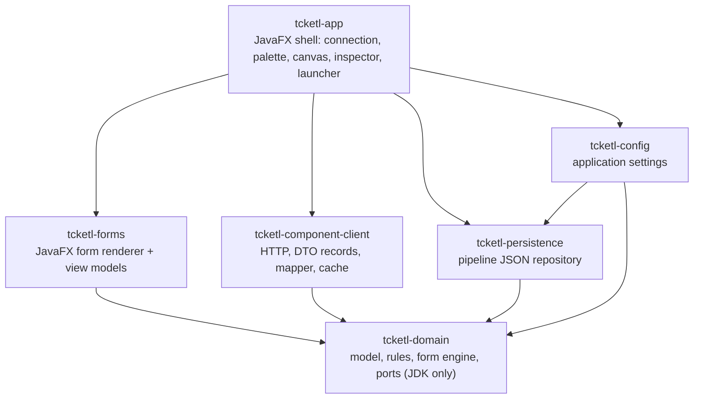
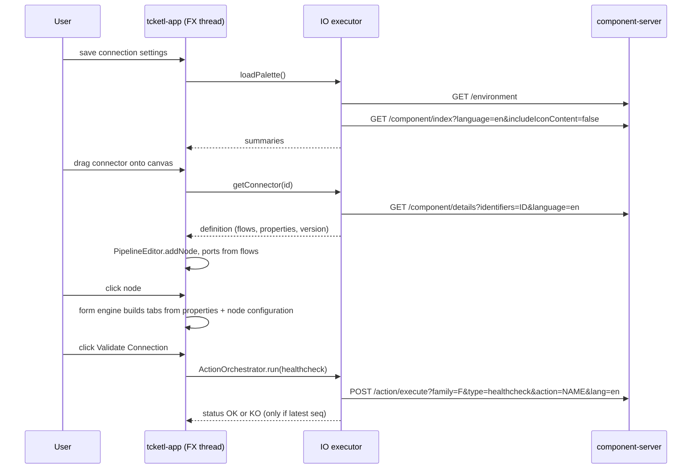

# tcketl - Architecture

## 4. Architecture

### 4.1 Modules (`tcketl/`, as built)

| Module | Responsibility | Key types (as built) |
|---|---|---|
| `tcketl-parent` | aggregator, dependency management (`openjfx.version`, `jsvg.version`, Jackson from root), enforcer rule | - |
| `tcketl-domain` | pure core, **JDK only** | `connector` (`ConnectorId`, `ConnectorRef`, `ConnectorSummary`, `ConnectorDefinition`, `ConnectorRole`, `Port`); `pipeline` (`Pipeline`, `Node`, `NodeId`, `Link`, `Endpoint`, `Position`, `PipelineEditor`, `PipelineEvent`, `PipelineListener`, `PipelineProblem`, `LinkRejection`, `Resolution`); `property` (`PropertyDefinition`, `PropertyType`, `Constraints`, `UiHints`, `LayoutHints`, `GridLayout`, `VisibilityCondition`, `ConditionClause`, `EvaluationStrategy`, `ActionBinding`, `ActionDefinition`, `ActionTypes`, `ConfigurationTypeRef`); `form` (`PropertyTree`, `PropertyNode`, `PropertyKind`, `PathResolver`, `Defaults`, `ConfigurationValues`, `ConfigurationCodec`, `FormValues`, `ValueWalker`, `LayoutResolver`, `FormLayout`, `FormOptions`, `Validator`, `ValidationIssue`, `Visibility`); `server` (ports `ComponentCatalog`, `IconSource`, `DocumentationSource`; `ServerEndpoint`, `ServerStatus`, `ServerTimeouts`, `ServerException`, `ServerUnavailableException`, `ServerProtocolException`); `Preconditions` |
| `tcketl-config` | application settings (`--config` > `TCKETL_CONFIG` > OS default), tolerant to unknown keys, invalid file -> defaults + warning, never overwritten silently | `ApplicationConfig`, `ConfigFile`, `ConfigLoadResult`, `ConfigLocator`, `ConfigStore`, `FileConfigStore` |
| `tcketl-persistence` | pipeline file I/O, format versioning, shared JSON file primitives (atomic write, strict parsing) | `PipelineRepository`, `FileSystemPipelineRepository`, `PipelineFile`, `JsonFiles`, `FormatVersion`, `FileFormatException` |
| `tcketl-component-client` | the **only** module that talks to the server; only `ComponentServerClient` is public | `ComponentServerClient`, `HttpTransport`, `Wire` (DTO records), `MetadataParser`, `ConnectorMapper`, `HttpComponentCatalog`, `CachingComponentCatalog` |
| `tcketl-forms` | JavaFX rendering of the generated forms (**P7 in progress**) | built: `WidgetKind`, `WidgetSelector`, `Texts`, `FormViewModel`; to come: `FormBindings`, `Editors`, `FormBuilder`, `FormView`, `forms.css` |
| `tcketl-app` | composition root, views, project management, async helpers | `Launcher`, `TcketlApp`, `CompositionRoot`, `MainWindow`, `MainController` (+ `MainView.fxml`, `tcketl.css`); `async` (`AsyncRunner`, `Cancellable`, `LazyResources`); `connection`; `session` (`ServerSession`, `ServerConnection`, `ClientServerConnection`, `Problems`); `palette` (`PaletteView`, `PaletteViewModel`, `RoleResolver`, ...); `icon` (`IconService`, `SvgRasterizer`, ...); `canvas` (`CanvasView`, `CanvasViewModel`, `NodeView`, `PortView`, `LinkView`, `ProblemsView`, `Selection`); `pipeline` (`NodeResolver`); `project` (`ProjectService`, `ProjectActions`, dialogs); `ui` (`RoleGlyph`) |

Dependency direction: `app -> forms / client / persistence / config -> domain` (`config -> persistence`). The domain is
JDK only.

### 4.2 Patterns and layering

Hexagonal: domain + ports at the centre; HTTP and file I/O are adapters; MVVM in the UI. Anti-corruption layer (the
mapper) so no `ui::...`/`condition::...` string leaks out of `tcketl-component-client`. Decorator (caching catalog),
Builder (form), Observer (`PipelineEditor` listeners, JavaFX properties), manual DI in `CompositionRoot`. The domain
`Pipeline` is an immutable snapshot; `PipelineEditor` applies commands, notifies listeners and bumps a revision (dirty
tracking); it is **not thread-safe** (FX thread only). The form engine values are immutable (`FormValues`).

### 4.3 Threading and async

- JavaFX thread: UI only; every domain mutation happens there (single writer).
- `AsyncRunner` (`tcketl-app`): `production()` = daemon IO pool + delivery on the FX thread; `of(io, ui)`; `direct()` for
  tests; `submit(work, onSuccess, onFailure)` returns a `Cancellable`. **No timer / delayed scheduling yet** - P9 needs
  one for the 300 ms debounce and the update polling of P10.
- Catalog caches are thread-safe. Java 17: no virtual threads / structured concurrency.

### 4.4 Caching (the server has no ETag)

`CachingComponentCatalog`: index and details cached and invalidated when the environment stamp (`lastUpdated` +
`pluginsHash`) changes or on manual refresh, with a generation counter so a stale in-flight response is not stored.
Icons are loaded lazily and cached per key by the app `IconService` (`LazyResources`, placeholder meanwhile). To do in P9: `dynamic_values` by `(family, action, lang)`, suggestions only
when `cacheable=true`.

### 4.5 Canonical flow

The last four steps (inspector form, healthcheck) are the remaining P7-P9 work.

### 4.6 Errors

`HttpTransport` maps: IO/timeout -> `ServerUnavailableException`; non-2xx -> `ServerException(status, ErrorPayload)`;
`400` on details -> per-id payload map; `404` on icons -> placeholder; JSON failure -> `ServerProtocolException`. The app
turns them into banners/notices; descriptions are shown as detail text and never parsed (blueprint A16).
`/cache/clear` is never called.

### 4.7 Build and quality gates (inherited from the root pom, unmodified)

- Spotless `apply` runs at `process-classes` and **rewrites main and test sources** (Talend formatter: 4 spaces, 120
  columns; import order `java`, `javafx`, `javax`, then third party; static imports first in tests). Re-view a file
  after a build before editing it again.
- Checkstyle (main only): `FinalParameters`, `NeedBraces`, `MissingSwitchDefault`, `AvoidStarImport`, `LineLength` 180,
  `ImportOrder`, no tabs.
- RAT at `verify`: json/md/adoc are excluded; FXML, CSS, `.properties`, SVG need the license header. Every Java file
  needs the Talend header (`/** Copyright (C) 2006-2026 Talend Inc. - www.talend.com ... Apache 2.0 */`; CSS uses the
  `/* ... */` form seen at the top of `tcketl.css`).
- Compiler `-Xlint:all,-processing` (exceptions need `serialVersionUID`), `-parameters`; JaCoCo; enforcer.
- Version drift: the root release tooling does not see `tcketl/`; when the root version changes, bump the parent
  version of the `tcketl` poms (`mvn -f tcketl/pom.xml versions:set -DnewVersion=<version>`).

### 4.8 Testing strategy

| Layer | Approach |
|---|---|
| domain | plain JUnit 5 over fixtures |
| client | mapper tests on fixtures; `HttpServer` stub: 200, `400` map, `404`, `500`, timeout, gzip, `lastUpdated` opaque |
| view models | JavaFX properties, no toolkit (in `tcketl-forms` and `tcketl-app`) |
| views | **opt-in** toolkit tests in `tcketl-app` (skipped unless `-Dtcketl.ui.snapshots=<dir>`): off-screen `Scene.snapshot` PNGs through the **real input pipeline** (`FxHarness`); do not unit-test views in `tcketl-forms` (creating controls without a toolkit is unreliable) |
| live contract (opt-in) | `-Dtcketl.ui.config=<settings file>` renders the window against a real server; fixtures `real-*` were recorded from one |

Fixtures live in `tcketl-component-client/src/test/resources/fixtures` and are **copies** (never references) of the
`docs/tck-api-sample` payloads cleaned of BOM and truncation markers (`sample-*`), full payloads recorded from a live
local server (`real-*`) and hand-built ones (`synthetic-*`), because `docs/` is untracked.

## 8. Design log: divergences from the original plan (to document in P11)

- **P2**: `tcketl-config` depends on `tcketl-persistence`; `ServerTimeouts` in the domain; kebab-case file DTOs; pipelines REQUIRE `format-version`; atomic writes; server exceptions in the domain; `ActionInvoker` deferred to P9; extra `LINK_FLOW_UNKNOWN` problem.
- **P3**: typed property model in `domain.property`; `IconSource`/`DocumentationSource` ports in the domain; only `ComponentServerClient` public; retry loop in `connectors(ids)`; caching decorator with generation counter; a property without a path is dropped.
- **P4**: palette grouping in the app; `ServerSession`/`ServerConnection`; `AsyncRunner`/`LazyResources`; icons always LIGHT; `MainWindow` extracted; message area in the connection dialog; opt-in snapshot harness (`FxHarness`).
- **P5**: phantom ports for link-referenced flows; double-click adds from the palette; snap-to-grid 20, clamp >= 20 (cap 50 000); unique node labels; a Resolved node survives a failed re-resolution; `NodeResolver` re-resolves on Reset/connection change/CONNECTED; Save-As names an `Untitled` pipeline after the file, extension `.tcketl.json`; drag only output -> input; zoom 25%-200%; Problems panel collapsed when empty; window title bound to the project; File menu disabled while busy.
- **P6**: flat immutable `ConfigurationValues`/`FormValues` instead of a nested tree; tabs = union of pane names (Main first); each leaf placed once; root `$` options in Advanced; buttons once per object; object with no rows shows nothing; update button with unknown `::after` appended; guess-schema offered for every OUT structure (P9 hides it if no action); encode rules (keep empty STRING with non-empty default, drop other empties, `p[length]=0` for an emptied array with a non-empty default); `pattern` uses JS find semantics; `Validator` skips non-displayed properties; only array and map defaults expanded; no `ConfigurationCodec.decode`.
- **P7**: widget strategy = `WidgetKind` + selector + grouped `Editors` (not one class per widget); no 200 ms debounce; `${index}` shown 1-based; datetime = text + hint; suggestion/dynamic = editable combos until P9; node validity badge in P8; programmatic pulls never write.

